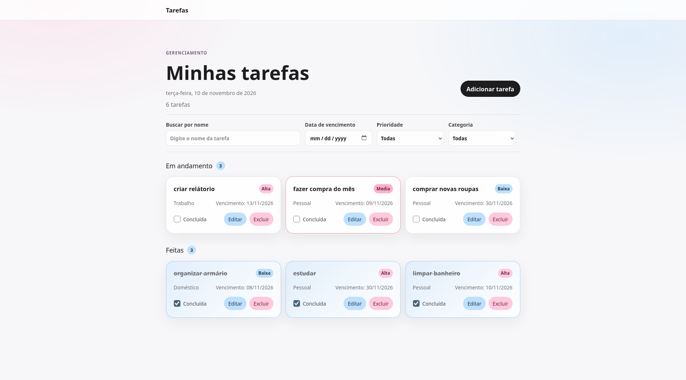

## Taskmanager

Gerenciador de tarefas com prioridade, categoria e data de vencimento, desenvolvido em [Angular](https://angular.dev/) com API local em JSON Server.



## Funcionalidades

- Listagem de tarefas separada em **Em andamento** e **Feitas**, com contador em cada seção
- Cadastro, edição e exclusão de tarefas
- Marcar tarefa como concluída (título riscado e movida para "Feitas")
- Busca por nome e filtros por **data de vencimento**, **prioridade** (Alta, Média, Baixa) e **categoria** (Trabalho, Pessoal, Doméstico)
- Destaque visual para tarefas **atrasadas**
- Persistência dos dados via API REST local

## Tecnologias

- [Angular](https://angular.dev/) 22 (Angular CLI 22.2.5)
- [JSON Server](https://github.com/typicode/json-server) (API REST local)

## Como executar

```bash
# instalar dependências
npm install

# terminal 1: API em http://localhost:3000
npm run api

# terminal 2: aplicação em http://localhost:4200
ng serve
```
A coleção de tarefas fica em `http://localhost:3000/tarefas` e os dados são armazenados em `db.json`.

```bash
ng test
```
